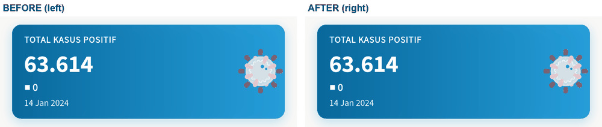
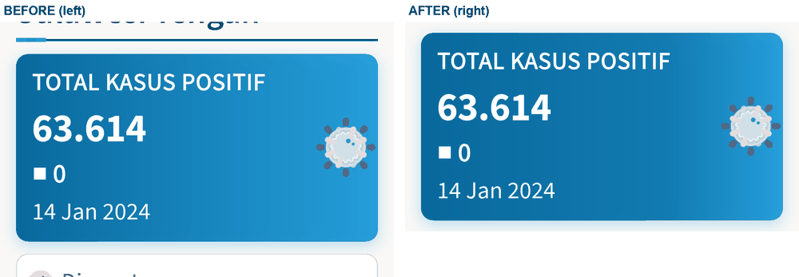
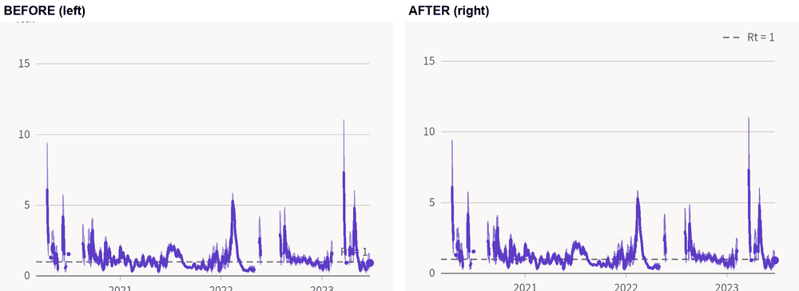

# Contrast and accessibility audit

Date: 2026-10-25. Scope: the Flutter app on `master` (original PICO look from
`pico_ui_kit`), light and dark, every screen. Target: WCAG 2.2 AA. The look
was not redesigned: only failures and clear defects were changed.

## Summary

| | Before | After |
|---|---|---|
| Token pairs below their WCAG minimum (of 212 enumerated pairs, light + dark) | 8 | 0 |
| Rendered text below 4.5:1 / 3:1 (widget tests and emulator) | 1 (hero label, light) | 0 |
| Other defects (Rt label overlap, missing programmatic label) | 2 | 0 |
| Contrast test files that pass on Linux at 1x | 4 of 12 (stock guideline, no 2x workaround) | 12 of 12, no workaround |

The 8 token failures:

| Pair | Theme | Before | After | Fix |
|---|---|---|---|---|
| White hero text at the end of its text column | light | 4.43:1 at 1x, 4.0:1 at 150 %, 3.6:1 at 200 % (emulator) | 4.61:1 at 1x, 150 % and 200 % | See "Hero" below |
| Rt credible band edge on page / card | light | 2.61 / 2.66 | 3.56 / 3.67 | Edge opacity .55 to .70 (`ChartPainter.bandEdgeAlpha`) |
| Rt credible band edge on page / card | dark | 2.85 / 2.63 | 3.75 / 3.36 | same |
| `foreground.primary` on page / card / info surface | dark | 2.62 / 2.23 / 1.99 | 7.24 / 6.17 / 5.50 | The dark theme used the light token; now `primaryDark` (`40BBF0`) |

The 2 other defects:

- **Rt = 1 label.** It was painted on the rule, before the Rt line, so recent
  values crossed it. It is now a key above the plot, top right (a dashed
  sample and "Rt = 1"), so it covers no data and no rule.
- **Text fields had no programmatic label.** `PicoTextField` drew its label as
  a separate text above an unnamed edit box (WCAG 1.3.1, 4.1.2). The label now
  names the field and the loose text is excluded, so the semantics tree has
  exactly one node with the label: the text field ("Cari rumah sakit", then
  the hint "Nama"). A test walks the tree and asserts this.

### Hero

The original gradient (dark blue `09689B` to the logo blue `0B92D5` at 85 %,
left to right) cannot carry white small text all the way: white measures
4.5:1 only up to 38 % of the width in light mode (2.9:1 at the light end;
dark mode 4.3:1 at the end). The label already ends at 38 % at 1x in
Indonesian and goes further in English and at larger text (53 % at 150 %,
69 % at 200 %).

The fix keeps the original gradient, direction and both end colours. The card
measures its own widest text line. When the text ends before 33 % of the
width, the gradient is exactly the original. When it ends later, the stretch
under the text runs from the dark end to the 33 % colour, and the rest of the
card still ends on the original light blue. At 1x this moves the colour at
the end of the label from the 38 % point to the 33 % point of the gradient
(a few percent darker there, nothing elsewhere); at 200 % text the column is
held at the 33 % colour instead of reaching the 69 % colour. Measured on the
emulator after: 4.61:1 light, 5.27:1 dark, at 1x, 150 % and 200 %.

### Rt chart

## Why the contrast tests failed at 1x on Linux

The widget tests used Flutter's `textContrastGuideline`. It renders the frame,
splits each text box at its average lightness and takes the **most frequent**
pixel of the darker half as the text colour.

A probe (12 px Source Sans 3 Regular, `#535352` on white, 7.26:1) gives:

| Raster | Darkest pixel | Most frequent dark pixel | Stock guideline |
|---|---|---|---|
| macOS (CoreText) | `#535353` | `#535353` x92 | 7.26:1, pass |
| Linux arm64 Docker, Flutter 3.47.4 (FreeType) | `#535353` | `#868686` x25 | 3.64:1, fail |
| Linux, `devicePixelRatio = 2` (the old `hiDpi` workaround) | `#535353` | `#868686` x25 | 3.64:1, fail |

The full ink is painted on Linux too, but FreeType's softer stems make an
anti-aliasing step the mode. CI saw 1.4:1 on other strings for the same
reason. The 2x workaround could not fix this: the stock guideline renders its
image with `pixelRatio: 1 / devicePixelRatio`, back to logical pixels, so it
samples the same image. It passed on CI by chance of glyph placement. The
stock guideline also never checked text inside `ExcludeSemantics`, which is
how the stat tiles and the hero expose one combined label.

**Fix at the root.** `package:pico_ui_kit/testing.dart` adds
`picoTextContrastGuideline`, now used by all 12 test files (the `hiDpi`
helper is deleted). For every visible, hit-testable `RenderParagraph`,
including text under `ExcludeSemantics`, it:

1. reads the colour each text run declares and multiplies in ancestor
   opacity (exact token math, no guessing of the ink from pixels);
2. paints the paragraph again, alone, as a mask on the same physical pixels,
   and takes as background **every** box pixel the glyphs and their
   anti-aliased edges (one pixel wider) do not touch. Nothing is dropped for
   being close to the ink colour; the ratio is the 2nd percentile, so a
   gradient counts at its weak end. No visible background is a failure;
3. checks the frame: where the mask covers a pixel by 60 % or more, the frame
   must show the declared colour blended over the local background by that
   coverage (median within 20/255), so a shader, a colour filter or a wrong
   declared colour fails;
4. uses the WCAG large-text rule after the text scaler (24 px, or 18.66 px
   bold).

An earlier version of this guideline (first push of this PR) took the
background from the box's edge rows and dropped pixels within 1.15:1 of the
ink. Review found that this hid the worst cases (ink on a near-ink ground,
gradients fading towards the ink); the mask replaces it.

Its tests (`packages/pico_ui_kit/test/testing/pico_text_contrast_guideline_test.dart`)
cover: thin 12 px text at 7:1 passes at 1x; grey at 2.5:1 fails; large text
at 3:1 passes; `#777777` on `#7A7A7A` fails; a gradient fading towards the
ink fails; text under `ExcludeSemantics` is checked; ancestor opacity counts;
a hue filter and a fading filter fail the frame check; icons are skipped.
They and all feature contrast tests pass at 1x on macOS and in the Linux
container. The Beranda test gained an "en light x1.5" case, which fails on
the old hero (4.04:1) and passes now.

Limits (also in the guideline's dartdoc): only text hit-testable at the
centre of its box is checked; the background is the text box only; the
frame check needs at least 3 pixels covered 60 % or more and one colour per
paragraph; `ShaderMask` and `TextOverflow.fade` are not reproduced by the
mask, so the frame check is lenient there; `ColorFiltered` is not counted in
the token step, only by the frame check; paragraphs with `WidgetSpan`s fall
back to the box's most frequent colour; icon glyphs are left to the token
test.

## Method

1. **Token math.** `packages/pico_ui_kit/test/foundations/themes/pico_contrast_test.dart`
   enumerates every pair the kit composes (text roles on page, card, subtle
   and strong grounds; status text on its surface; filled actions; Material
   scheme roles used by stock widgets, including snack bar and selected
   chips; hero; map labels and marks; outlines; focus; series marks, icons in
   their badges, the Rt band edge and the axis). Translucent colours are
   composited over their real ground. It also pins the series and blue hex
   values to their steps of the original palette (`feature/monorepo`
   `pico_colors.dart`), so a later fix cannot drift the brand silently. Run
   with `PICO_CONTRAST_REPORT=1` to print the table below.
2. **Rendered check.** The guideline above, in light and dark, at 1x, 1.5x
   and 2x text, on Beranda, Statistik (province, kabupaten, Rt, tests),
   Peta, Vaksin, Rumah sakit, Satgas, Isoman, Infografis, Info, Tentang,
   tips and Pengaturan.
3. **Emulator.** Dev flavour (debug) on `emulator-5554` (1080x2280, 440 dpi),
   system light and dark, font scale 1.0, 1.5 and 2.0. Each screen was
   captured with `adb screencap` together with `uiautomator dump` (the
   accessibility tree TalkBack reads). For each node the background is the
   most frequent pixel and the ink the pixel of highest contrast. Every node
   flagged below 4.5:1 was either the hero (fixed), a disabled control
   (exempt) or a node half scrolled under the app bar.
4. **Colour vision.** Machado et al. (2009) dichromat matrices, CIE76 delta E
   between the four case series.
5. **Semantics.** Flutter's tap-target (48 dp Android, 44 pt iOS) and
   labelled-tap-target guidelines in every a11y test; emulator dump for
   unlabelled or small clickable nodes; reduced motion read from source.

## Emulator samples (after)

| Element | Light | Dark |
|---|---|---|
| Hero label, white on gradient at the end of the text column | 4.61:1 (1x, 150 %, 200 %) | 5.27:1 |
| Body text on page | 14.95:1 | 14.07:1 |
| Tile caption and date (`foreground.subtle` on card) | 7.70:1 | 5.37:1 |
| Navigation, unselected / selected label | 7.70 / 6.06:1 | 5.37 / 6.17:1 |
| Banner text on tint | 13.84:1 | 10.69:1 |
| Selected segment (`onSecondaryContainer` on tint) | 6.73:1 | 7.18:1 |
| Map name on region / on page | 13.84 / 14.95:1 | 10.69 / 14.07:1 |
| Disabled "Bandingkan" (exempt) | 2.66:1 | 3.55:1 |

Screens (before this PR): [Beranda light](contrast-audit/home-light.png),
[Beranda dark](contrast-audit/home-dark.png),
[Statistik light](contrast-audit/statistik-light.png),
[Peta dark](contrast-audit/peta-dark.png).

## Other checks

- **Touch targets.** Every clickable node is at least 48x48 dp in widget
  tests and on the emulator.
- **TalkBack.** All controls have a label or a tooltip. The in-page back
  arrows are named through `Tooltip` (TalkBack reads it; `uiautomator`
  shows them as NAF because it does not print tooltips). Tiles and the hero
  read as one sentence: label, figure, change, date. Order follows the
  layout. Live TalkBack speech was not recorded.
- **Text scale 200 %.** No clipping or overlap on Beranda, Statistik, Info
  and Pengaturan on the emulator; the hero label and date become large text
  (24 px). The widget tests cover every screen at 2x.
- **Reduced motion.** Chart draw-on and pulse, the woven bars, Lottie and the
  banner carousel honour `MediaQuery.disableAnimations`. Page cross-fades
  (300 ms opacity) are not motion.
- **Focus.** `outline.focus` is 5.71:1 or more on page and card.

## Goldens

All golden files were regenerated on macOS (CI does not run goldens).

Changed by this PR (they passed on `master`, or the change is ours):

| Golden | Why |
|---|---|
| `pico_ui_kit` charts: `charts_light_x1`, `charts_light_x2`, `charts_dark_x1`, `charts_dark_x2`, `charts_3x_scrub` | Rt band edge opacity, Rt = 1 key above the plot |
| `pico_ui_kit` themes: `semantic_colors_comparison`, `radius_scale`, `spacing_scale`, `typography_overview_comparison` | Dark `foreground.primary` (these show it in the dark half) |
| `statistik`: `rt_light_x1`, `rt_dark_x2`, `greyscale_rt` | Rt = 1 key and band edge |
| `home`: `home_light_x1`, `home_light_x2`, `home_dark_x1`, `home_dark_x2` | Hero gradient (these also failed on `master`, see below) |

Already failing on `master` on macOS, **not** changed here (reverted to the
`master` files): `peta`: `peta_light_x1`, `peta_dark_x2`, `greyscale_peta`;
`statistik`: `area_light_x2`, `area_dark_x2`, `kabupaten_light_x1`,
`kabupaten_dark_x2`, `profile_light_x1`, `profile_dark_x2`,
`greyscale_province`; `vaksin`: `vaksin_light_x2`, `vaksin_dark_x2`. The only
difference is the "diperbarui N hari lalu" footer: those tests read the wall
clock, so the goldens go stale every day (1013 on the golden, 1014 today).
The same applies to the `home` and `rt` goldens above. Freezing the clock in
those tests is a separate fix.

## Justified leftovers

- **Deuteranopia, light theme: Dirawat (`8A5A00`) and Meninggal (`B42318`)
  merge (delta E 2.2).** Both are steps of the original amber and red
  families at the same lightness. They are never the only cue: the series
  use a triangle mark and dashed line versus bars and a doubled line, and
  every tile and legend has its label. The token test asserts this is the
  only colour-blind merge in either theme, and that merged pairs differ in
  mark and line. Changing a hue would change the original look.
- **`activeLight` `8A5A00`** is not an exact step of the original amber
  family: warning 700 (`B28000`) is 3.3:1 on paper, so the token sits between
  700 and 800 (`7A5900`). It is pinned in the test.
- **Map names are 10 px** (they scale with the text setting). They pass
  contrast (10.7:1 and up), and the same names, values and actions are in the
  Daftar tab and on every mark's label.
- **Disabled controls** ("Bandingkan" when the chart is not cumulative) stay
  below 4.5:1, as WCAG 1.4.3 allows.
- **`outline.subtle` dividers and the chart grid** are decorative (1.3 to
  1.5:1) and exempt.
- **Rt mark on a selected dark region** is exactly 3.00:1.

## Token table (after)

212 pairs, light and dark

| Theme | Kind | Pair | Fg | Bg | Ratio | Min |
|---|---|---|---|---|---|---|
| dark | focus | outline.focus on card | #40BBF0 | #302E2C | 6.17 | 3.0 |
| dark | focus | outline.focus on page | #40BBF0 | #24221F | 7.24 | 3.0 |
| dark | graphic | active icon in its badge | #FDC941 | #4D442F | 6.26 | 3.0 |
| dark | graphic | active mark on card | #FDC941 | #302E2C | 8.76 | 3.0 |
| dark | graphic | active mark on page | #FDC941 | #24221F | 10.28 | 3.0 |
| dark | graphic | active mark on selected region | #FDC941 | #4F624D | 4.26 | 3.0 |
| dark | graphic | active mark on strong | #FDC941 | #0C3A52 | 7.81 | 3.0 |
| dark | graphic | active mark on subtle | #FDC941 | #3A3836 | 7.56 | 3.0 |
| dark | graphic | chart axis and Rt = 1 rule on card | #8E8D8B | #302E2C | 4.08 | 3.0 |
| dark | graphic | chart axis and Rt = 1 rule on page | #8E8D8B | #24221F | 4.78 | 3.0 |
| dark | graphic | deceased icon in its badge | #F97066 | #4C3734 | 3.95 | 3.0 |
| dark | graphic | deceased mark on card | #F97066 | #302E2C | 4.85 | 3.0 |
| dark | graphic | deceased mark on page | #F97066 | #24221F | 5.69 | 3.0 |
| dark | graphic | deceased mark on selected region | #F97066 | #4E4958 | 3.11 | 3.0 |
| dark | graphic | deceased mark on strong | #F97066 | #0C3A52 | 4.33 | 3.0 |
| dark | graphic | deceased mark on subtle | #F97066 | #3A3836 | 4.19 | 3.0 |
| dark | graphic | map region outline on region | #A4A3A2 | #0C3A52 | 4.79 | 3.0 |
| dark | graphic | outline.main (control edge) on card | #8E8D8B | #302E2C | 4.08 | 3.0 |
| dark | graphic | outline.main (control edge) on page | #8E8D8B | #24221F | 4.78 | 3.0 |
| dark | graphic | outline.main (control edge) on strong | #8E8D8B | #0C3A52 | 3.63 | 3.0 |
| dark | graphic | outline.main (control edge) on subtle | #8E8D8B | #3A3836 | 3.52 | 3.0 |
| dark | graphic | positive icon in its badge | #40BBF0 | #324247 | 4.79 | 3.0 |
| dark | graphic | positive mark on card | #40BBF0 | #302E2C | 6.17 | 3.0 |
| dark | graphic | positive mark on page | #40BBF0 | #24221F | 7.24 | 3.0 |
| dark | graphic | positive mark on selected region | #40BBF0 | #1B5E7E | 3.25 | 3.0 |
| dark | graphic | positive mark on strong | #40BBF0 | #0C3A52 | 5.50 | 3.0 |
| dark | graphic | positive mark on subtle | #40BBF0 | #3A3836 | 5.33 | 3.0 |
| dark | graphic | recovered icon in its badge | #3CCB7F | #324438 | 4.98 | 3.0 |
| dark | graphic | recovered mark on card | #3CCB7F | #302E2C | 6.47 | 3.0 |
| dark | graphic | recovered mark on page | #3CCB7F | #24221F | 7.59 | 3.0 |
| dark | graphic | recovered mark on selected region | #3CCB7F | #19635F | 3.37 | 3.0 |
| dark | graphic | recovered mark on strong | #3CCB7F | #0C3A52 | 5.76 | 3.0 |
| dark | graphic | recovered mark on subtle | #3CCB7F | #3A3836 | 5.58 | 3.0 |
| dark | graphic | Rt band edge on card | #7F78B4 | #302E2C | 3.36 | 3.0 |
| dark | graphic | Rt band edge on page | #7B74B0 | #24221F | 3.75 | 3.0 |
| dark | graphic | rt icon in its badge | #A197EE | #403D47 | 4.15 | 3.0 |
| dark | graphic | rt mark on card | #A197EE | #302E2C | 5.27 | 3.0 |
| dark | graphic | rt mark on page | #A197EE | #24221F | 6.18 | 3.0 |
| dark | graphic | rt mark on selected region | #A197EE | #36547E | 3.00 | 3.0 |
| dark | graphic | rt mark on strong | #A197EE | #0C3A52 | 4.69 | 3.0 |
| dark | graphic | rt mark on subtle | #A197EE | #3A3836 | 4.55 | 3.0 |
| dark | graphic | selected nav icon on its indicator | #40BBF0 | #0C3A52 | 5.50 | 3.0 |
| dark | text | action.destructive as text on card | #F97066 | #302E2C | 4.85 | 4.5 |
| dark | text | action.destructive as text on page | #F97066 | #24221F | 5.69 | 4.5 |
| dark | text | action.primary as text on card | #40BBF0 | #302E2C | 6.17 | 4.5 |
| dark | text | action.primary as text on page | #40BBF0 | #24221F | 7.24 | 4.5 |
| dark | text | action.secondary as text on card | #82D2F7 | #302E2C | 8.06 | 4.5 |
| dark | text | action.secondary as text on page | #82D2F7 | #24221F | 9.45 | 4.5 |
| dark | text | action.success as text on card | #3CCB7F | #302E2C | 6.47 | 4.5 |
| dark | text | action.success as text on page | #3CCB7F | #24221F | 7.59 | 4.5 |
| dark | text | foreground.error on card | #F97066 | #302E2C | 4.85 | 4.5 |
| dark | text | foreground.error on its status surface | #F97066 | #3F1F1C | 5.29 | 4.5 |
| dark | text | foreground.error on page | #F97066 | #24221F | 5.69 | 4.5 |
| dark | text | foreground.info on card | #40BBF0 | #302E2C | 6.17 | 4.5 |
| dark | text | foreground.info on its status surface | #40BBF0 | #0C3A52 | 5.50 | 4.5 |
| dark | text | foreground.info on page | #40BBF0 | #24221F | 7.24 | 4.5 |
| dark | text | foreground.inverse on action.destructive | #24221F | #F97066 | 5.69 | 4.5 |
| dark | text | foreground.inverse on action.destructive hover | #24221F | #F97066 | 5.69 | 4.5 |
| dark | text | foreground.inverse on action.primary | #24221F | #40BBF0 | 7.24 | 4.5 |
| dark | text | foreground.inverse on action.primary hover | #24221F | #82D2F7 | 9.45 | 4.5 |
| dark | text | foreground.inverse on action.secondary | #24221F | #82D2F7 | 9.45 | 4.5 |
| dark | text | foreground.inverse on action.secondary hover | #24221F | #40BBF0 | 7.24 | 4.5 |
| dark | text | foreground.inverse on action.success | #24221F | #3CCB7F | 7.59 | 4.5 |
| dark | text | foreground.inverse on action.success hover | #24221F | #40BBF0 | 7.24 | 4.5 |
| dark | text | foreground.inverse on background.inverse | #24221F | #82D2F7 | 9.45 | 4.5 |
| dark | text | foreground.main on card | #F3F1EE | #302E2C | 12.00 | 4.5 |
| dark | text | foreground.main on page | #F3F1EE | #24221F | 14.07 | 4.5 |
| dark | text | foreground.main on strong | #F3F1EE | #0C3A52 | 10.69 | 4.5 |
| dark | text | foreground.main on subtle | #F3F1EE | #3A3836 | 10.36 | 4.5 |
| dark | text | foreground.muted on card | #A4A3A2 | #302E2C | 5.37 | 4.5 |
| dark | text | foreground.muted on page | #A4A3A2 | #24221F | 6.30 | 4.5 |
| dark | text | foreground.muted on strong | #A4A3A2 | #0C3A52 | 4.79 | 4.5 |
| dark | text | foreground.muted on subtle | #A4A3A2 | #3A3836 | 4.64 | 4.5 |
| dark | text | foreground.primary on card | #40BBF0 | #302E2C | 6.17 | 4.5 |
| dark | text | foreground.primary on its status surface | #40BBF0 | #0C3A52 | 5.50 | 4.5 |
| dark | text | foreground.primary on page | #40BBF0 | #24221F | 7.24 | 4.5 |
| dark | text | foreground.subtle on card | #A4A3A2 | #302E2C | 5.37 | 4.5 |
| dark | text | foreground.subtle on page | #A4A3A2 | #24221F | 6.30 | 4.5 |
| dark | text | foreground.subtle on strong | #A4A3A2 | #0C3A52 | 4.79 | 4.5 |
| dark | text | foreground.subtle on subtle | #A4A3A2 | #3A3836 | 4.64 | 4.5 |
| dark | text | foreground.success on card | #3CCB7F | #302E2C | 6.47 | 4.5 |
| dark | text | foreground.success on its status surface | #3CCB7F | #113524 | 6.44 | 4.5 |
| dark | text | foreground.success on page | #3CCB7F | #24221F | 7.59 | 4.5 |
| dark | text | foreground.warning on card | #FDC941 | #302E2C | 8.76 | 4.5 |
| dark | text | foreground.warning on its status surface | #FDC941 | #3D3010 | 8.35 | 4.5 |
| dark | text | foreground.warning on page | #FDC941 | #24221F | 10.28 | 4.5 |
| dark | text | hero white text on its lightest ground | #FFFFFF | #0B72A7 | 5.29 | 4.5 |
| dark | text | hero white text on the dark end | #FFFFFF | #09689B | 6.06 | 4.5 |
| dark | text | map label on region | #F3F1EE | #0C3A52 | 10.69 | 4.5 |
| dark | text | map label on selected active region | #F3F1EE | #4F624D | 5.83 | 4.5 |
| dark | text | map label on selected deceased region | #F3F1EE | #4E4958 | 7.69 | 4.5 |
| dark | text | map label on selected positive region | #F3F1EE | #1B5E7E | 6.31 | 4.5 |
| dark | text | map label on selected recovered region | #F3F1EE | #19635F | 6.26 | 4.5 |
| dark | text | map label on selected rt region | #F3F1EE | #36547E | 6.84 | 4.5 |
| dark | text | scheme inversePrimary / inverseSurface (snack bar action) | #24221F | #F3F1EE | 14.07 | 4.5 |
| dark | text | scheme onError / error | #24221F | #F97066 | 5.69 | 4.5 |
| dark | text | scheme onInverseSurface / inverseSurface (snack bar) | #24221F | #F3F1EE | 14.07 | 4.5 |
| dark | text | scheme onPrimary / primary | #24221F | #40BBF0 | 7.24 | 4.5 |
| dark | text | scheme onPrimaryContainer / primaryContainer | #82D2F7 | #0C3A52 | 7.18 | 4.5 |
| dark | text | scheme onSecondary / secondary | #24221F | #F97066 | 5.69 | 4.5 |
| dark | text | scheme onSecondaryContainer / secondaryContainer (selected chip, segment) | #82D2F7 | #0C3A52 | 7.18 | 4.5 |
| dark | text | scheme onSurface / surface | #F3F1EE | #24221F | 14.07 | 4.5 |
| dark | text | scheme onSurfaceVariant / surface | #A4A3A2 | #24221F | 6.30 | 4.5 |
| dark | text | scheme onSurfaceVariant / surfaceContainerHighest | #A4A3A2 | #3A3836 | 4.64 | 4.5 |
| dark | text | scheme onTertiary / tertiary | #24221F | #82D2F7 | 9.45 | 4.5 |
| dark | text | scheme primary / surface (text button) | #40BBF0 | #24221F | 7.24 | 4.5 |
| light | focus | outline.focus on card | #09689B | #FFFFFF | 6.06 | 3.0 |
| light | focus | outline.focus on page | #09689B | #F9F8F6 | 5.71 | 3.0 |
| light | graphic | active icon in its badge | #8A5A00 | #EFE8DB | 4.86 | 3.0 |
| light | graphic | active mark on card | #8A5A00 | #FFFFFF | 5.93 | 3.0 |
| light | graphic | active mark on page | #8A5A00 | #F9F8F6 | 5.58 | 3.0 |
| light | graphic | active mark on selected region | #8A5A00 | #C9C7B6 | 3.49 | 3.0 |
| light | graphic | active mark on strong | #8A5A00 | #E1F2FD | 5.17 | 3.0 |
| light | graphic | active mark on subtle | #8A5A00 | #F3F1EE | 5.26 | 3.0 |
| light | graphic | chart axis and Rt = 1 rule on card | #737271 | #FFFFFF | 4.80 | 3.0 |
| light | graphic | chart axis and Rt = 1 rule on page | #737271 | #F9F8F6 | 4.52 | 3.0 |
| light | graphic | deceased icon in its badge | #B42318 | #F5E0DF | 5.20 | 3.0 |
| light | graphic | deceased mark on card | #B42318 | #FFFFFF | 6.57 | 3.0 |
| light | graphic | deceased mark on page | #B42318 | #F9F8F6 | 6.19 | 3.0 |
| light | graphic | deceased mark on selected region | #B42318 | #D4B8BD | 3.57 | 3.0 |
| light | graphic | deceased mark on strong | #B42318 | #E1F2FD | 5.74 | 3.0 |
| light | graphic | deceased mark on subtle | #B42318 | #F3F1EE | 5.83 | 3.0 |
| light | graphic | map region outline on region | #535352 | #E1F2FD | 6.72 | 3.0 |
| light | graphic | outline.main (control edge) on card | #737271 | #FFFFFF | 4.80 | 3.0 |
| light | graphic | outline.main (control edge) on page | #737271 | #F9F8F6 | 4.52 | 3.0 |
| light | graphic | outline.main (control edge) on strong | #737271 | #E1F2FD | 4.19 | 3.0 |
| light | graphic | outline.main (control edge) on subtle | #737271 | #F3F1EE | 4.26 | 3.0 |
| light | graphic | positive icon in its badge | #09689B | #DDEAF1 | 4.93 | 3.0 |
| light | graphic | positive mark on card | #09689B | #FFFFFF | 6.06 | 3.0 |
| light | graphic | positive mark on page | #09689B | #F9F8F6 | 5.71 | 3.0 |
| light | graphic | positive mark on selected region | #09689B | #A5CBE2 | 3.54 | 3.0 |
| light | graphic | positive mark on strong | #09689B | #E1F2FD | 5.29 | 3.0 |
| light | graphic | positive mark on subtle | #09689B | #F3F1EE | 5.38 | 3.0 |
| light | graphic | recovered icon in its badge | #087443 | #DCECE5 | 4.77 | 3.0 |
| light | graphic | recovered mark on card | #087443 | #FFFFFF | 5.85 | 3.0 |
| light | graphic | recovered mark on page | #087443 | #F9F8F6 | 5.51 | 3.0 |
| light | graphic | recovered mark on selected region | #087443 | #A4CFC9 | 3.43 | 3.0 |
| light | graphic | recovered mark on strong | #087443 | #E1F2FD | 5.10 | 3.0 |
| light | graphic | recovered mark on subtle | #087443 | #F3F1EE | 5.19 | 3.0 |
| light | graphic | Rt band edge on card | #8E76D7 | #FFFFFF | 3.67 | 3.0 |
| light | graphic | Rt band edge on page | #8D74D4 | #F9F8F6 | 3.56 | 3.0 |
| light | graphic | rt icon in its badge | #5E3BC6 | #E8E4F7 | 5.77 | 3.0 |
| light | graphic | rt mark on card | #5E3BC6 | #FFFFFF | 7.20 | 3.0 |
| light | graphic | rt mark on page | #5E3BC6 | #F9F8F6 | 6.78 | 3.0 |
| light | graphic | rt mark on selected region | #5E3BC6 | #BCBFEE | 4.05 | 3.0 |
| light | graphic | rt mark on strong | #5E3BC6 | #E1F2FD | 6.28 | 3.0 |
| light | graphic | rt mark on subtle | #5E3BC6 | #F3F1EE | 6.39 | 3.0 |
| light | graphic | selected nav icon on its indicator | #09689B | #E1F2FD | 5.29 | 3.0 |
| light | text | action.destructive as text on card | #C8261A | #FFFFFF | 5.60 | 4.5 |
| light | text | action.destructive as text on page | #C8261A | #F9F8F6 | 5.28 | 4.5 |
| light | text | action.primary as text on card | #09689B | #FFFFFF | 6.06 | 4.5 |
| light | text | action.primary as text on page | #09689B | #F9F8F6 | 5.71 | 4.5 |
| light | text | action.secondary as text on card | #0C5880 | #FFFFFF | 7.71 | 4.5 |
| light | text | action.secondary as text on page | #0C5880 | #F9F8F6 | 7.27 | 4.5 |
| light | text | action.success as text on card | #087443 | #FFFFFF | 5.85 | 4.5 |
| light | text | action.success as text on page | #087443 | #F9F8F6 | 5.51 | 4.5 |
| light | text | foreground.error on card | #C8261A | #FFFFFF | 5.60 | 4.5 |
| light | text | foreground.error on its status surface | #C8261A | #FEF3F2 | 5.15 | 4.5 |
| light | text | foreground.error on page | #C8261A | #F9F8F6 | 5.28 | 4.5 |
| light | text | foreground.info on card | #09689B | #FFFFFF | 6.06 | 4.5 |
| light | text | foreground.info on its status surface | #09689B | #E1F2FD | 5.29 | 4.5 |
| light | text | foreground.info on page | #09689B | #F9F8F6 | 5.71 | 4.5 |
| light | text | foreground.inverse on action.destructive | #FFFFFF | #C8261A | 5.60 | 4.5 |
| light | text | foreground.inverse on action.destructive hover | #FFFFFF | #B42318 | 6.57 | 4.5 |
| light | text | foreground.inverse on action.primary | #FFFFFF | #09689B | 6.06 | 4.5 |
| light | text | foreground.inverse on action.primary hover | #FFFFFF | #0C5880 | 7.71 | 4.5 |
| light | text | foreground.inverse on action.secondary | #FFFFFF | #0C5880 | 7.71 | 4.5 |
| light | text | foreground.inverse on action.secondary hover | #FFFFFF | #09689B | 6.06 | 4.5 |
| light | text | foreground.inverse on action.success | #FFFFFF | #087443 | 5.85 | 4.5 |
| light | text | foreground.inverse on action.success hover | #FFFFFF | #0C5880 | 7.71 | 4.5 |
| light | text | foreground.inverse on background.inverse | #FFFFFF | #0C5880 | 7.71 | 4.5 |
| light | text | foreground.main on card | #24221F | #FFFFFF | 15.87 | 4.5 |
| light | text | foreground.main on page | #24221F | #F9F8F6 | 14.95 | 4.5 |
| light | text | foreground.main on strong | #24221F | #E1F2FD | 13.84 | 4.5 |
| light | text | foreground.main on subtle | #24221F | #F3F1EE | 14.07 | 4.5 |
| light | text | foreground.muted on card | #535352 | #FFFFFF | 7.70 | 4.5 |
| light | text | foreground.muted on page | #535352 | #F9F8F6 | 7.26 | 4.5 |
| light | text | foreground.muted on strong | #535352 | #E1F2FD | 6.72 | 4.5 |
| light | text | foreground.muted on subtle | #535352 | #F3F1EE | 6.83 | 4.5 |
| light | text | foreground.primary on card | #09689B | #FFFFFF | 6.06 | 4.5 |
| light | text | foreground.primary on its status surface | #09689B | #E1F2FD | 5.29 | 4.5 |
| light | text | foreground.primary on page | #09689B | #F9F8F6 | 5.71 | 4.5 |
| light | text | foreground.subtle on card | #535352 | #FFFFFF | 7.70 | 4.5 |
| light | text | foreground.subtle on page | #535352 | #F9F8F6 | 7.26 | 4.5 |
| light | text | foreground.subtle on strong | #535352 | #E1F2FD | 6.72 | 4.5 |
| light | text | foreground.subtle on subtle | #535352 | #F3F1EE | 6.83 | 4.5 |
| light | text | foreground.success on card | #087443 | #FFFFFF | 5.85 | 4.5 |
| light | text | foreground.success on its status surface | #087443 | #E5FBEC | 5.39 | 4.5 |
| light | text | foreground.success on page | #087443 | #F9F8F6 | 5.51 | 4.5 |
| light | text | foreground.warning on card | #7A5900 | #FFFFFF | 6.45 | 4.5 |
| light | text | foreground.warning on its status surface | #7A5900 | #FFF1CF | 5.75 | 4.5 |
| light | text | foreground.warning on page | #7A5900 | #F9F8F6 | 6.08 | 4.5 |
| light | text | hero white text on its lightest ground | #FFFFFF | #167CB2 | 4.59 | 4.5 |
| light | text | hero white text on the dark end | #FFFFFF | #09689B | 6.06 | 4.5 |
| light | text | map label on region | #24221F | #E1F2FD | 13.84 | 4.5 |
| light | text | map label on selected active region | #24221F | #C9C7B6 | 9.34 | 4.5 |
| light | text | map label on selected deceased region | #24221F | #D4B8BD | 8.62 | 4.5 |
| light | text | map label on selected positive region | #24221F | #A5CBE2 | 9.26 | 4.5 |
| light | text | map label on selected recovered region | #24221F | #A4CFC9 | 9.31 | 4.5 |
| light | text | map label on selected rt region | #24221F | #BCBFEE | 8.92 | 4.5 |
| light | text | scheme inversePrimary / inverseSurface (snack bar action) | #FFFFFF | #24221F | 15.87 | 4.5 |
| light | text | scheme onError / error | #FFFFFF | #C8261A | 5.60 | 4.5 |
| light | text | scheme onInverseSurface / inverseSurface (snack bar) | #F9F8F6 | #24221F | 14.95 | 4.5 |
| light | text | scheme onPrimary / primary | #FFFFFF | #09689B | 6.06 | 4.5 |
| light | text | scheme onPrimaryContainer / primaryContainer | #0C5880 | #E1F2FD | 6.73 | 4.5 |
| light | text | scheme onSecondary / secondary | #FFFFFF | #C8261A | 5.60 | 4.5 |
| light | text | scheme onSecondaryContainer / secondaryContainer (selected chip, segment) | #0C5880 | #E1F2FD | 6.73 | 4.5 |
| light | text | scheme onSurface / surface | #24221F | #F9F8F6 | 14.95 | 4.5 |
| light | text | scheme onSurfaceVariant / surface | #535352 | #F9F8F6 | 7.26 | 4.5 |
| light | text | scheme onSurfaceVariant / surfaceContainerHighest | #535352 | #F3F1EE | 6.83 | 4.5 |
| light | text | scheme onTertiary / tertiary | #FFFFFF | #0C5880 | 7.71 | 4.5 |
| light | text | scheme primary / surface (text button) | #09689B | #F9F8F6 | 5.71 | 4.5 |

## Colour-blind separation of the case series (CIE76 delta E)

| Theme | Vision | Pair | Delta E |
|---|---|---|---|
| dark | deutan | active / deceased | 37.5 |
| dark | deutan | active / recovered | 48.8 |
| dark | deutan | positive / active | 110.9 |
| dark | deutan | positive / deceased | 76.6 |
| dark | deutan | positive / recovered | 63.1 |
| dark | deutan | recovered / deceased | 13.8 |
| dark | protan | active / deceased | 58.6 |
| dark | protan | active / recovered | 39.8 |
| dark | protan | positive / active | 106.5 |
| dark | protan | positive / deceased | 55.9 |
| dark | protan | positive / recovered | 66.9 |
| dark | protan | recovered / deceased | 23.5 |
| dark | tritan | active / deceased | 45.4 |
| dark | tritan | active / recovered | 72.8 |
| dark | tritan | positive / active | 70.5 |
| dark | tritan | positive / deceased | 111.1 |
| dark | tritan | positive / recovered | 11.9 |
| dark | tritan | recovered / deceased | 113.8 |
| light | deutan | active / deceased | 2.2 |
| light | deutan | active / recovered | 33.3 |
| light | deutan | positive / active | 87.4 |
| light | deutan | positive / deceased | 85.3 |
| light | deutan | positive / recovered | 54.3 |
| light | deutan | recovered / deceased | 31.1 |
| light | protan | active / deceased | 17.4 |
| light | protan | active / recovered | 22.4 |
| light | protan | positive / active | 78.7 |
| light | protan | positive / deceased | 64.9 |
| light | protan | positive / recovered | 56.8 |
| light | protan | recovered / deceased | 15.3 |
| light | tritan | active / deceased | 44.7 |
| light | tritan | active / recovered | 63.1 |
| light | tritan | positive / active | 61.6 |
| light | tritan | positive / deceased | 105.8 |
| light | tritan | positive / recovered | 10.5 |
| light | tritan | recovered / deceased | 106.2 |

Under 10 means the colours read as one; those pairs differ in mark and line
form (enforced by the test).
